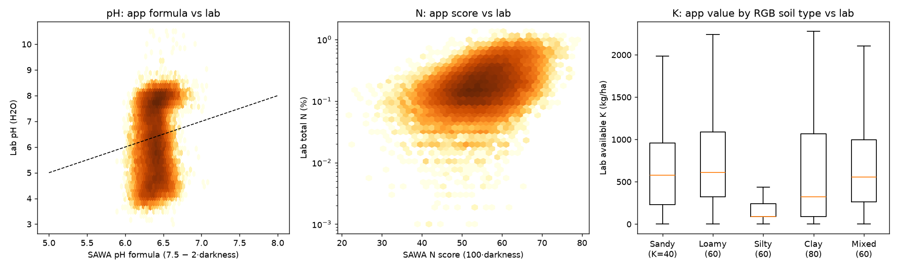
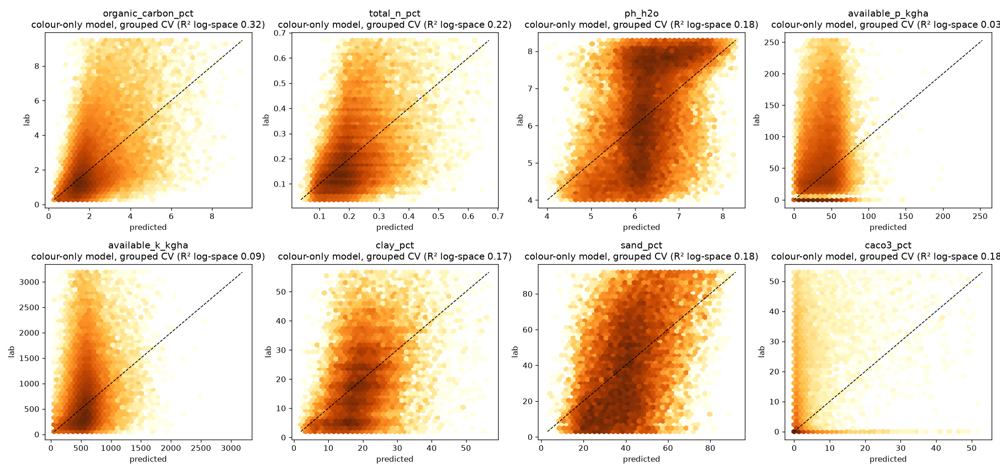
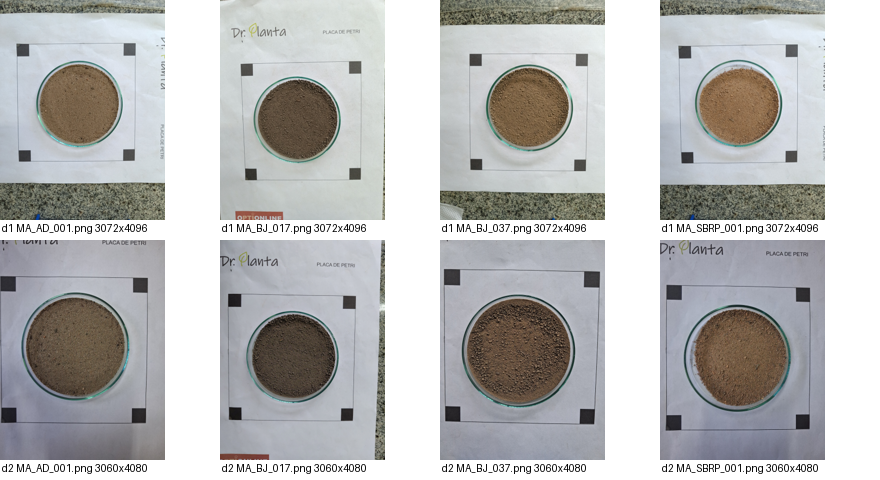
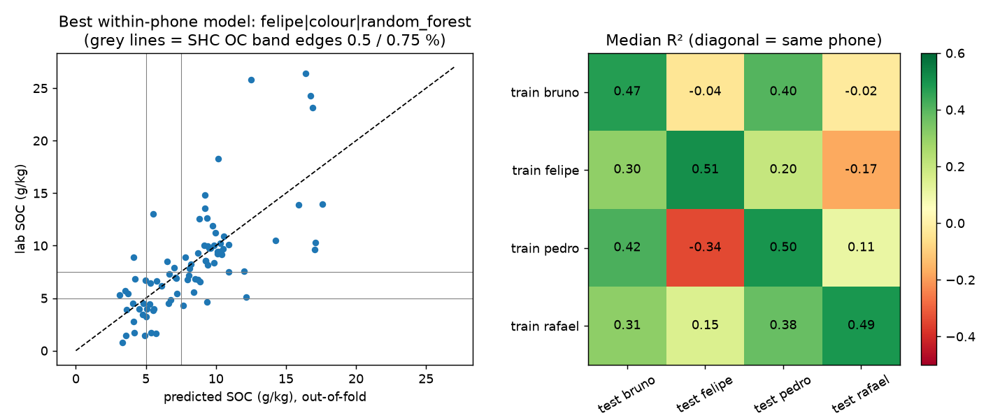
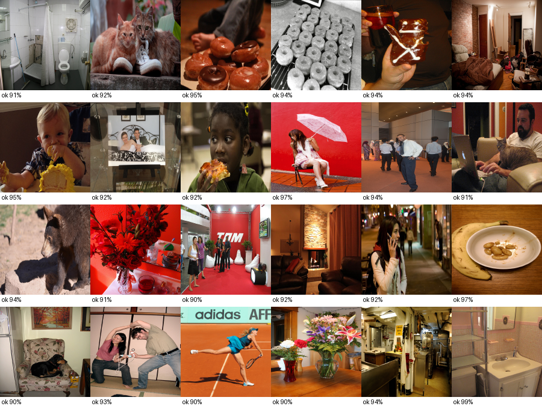
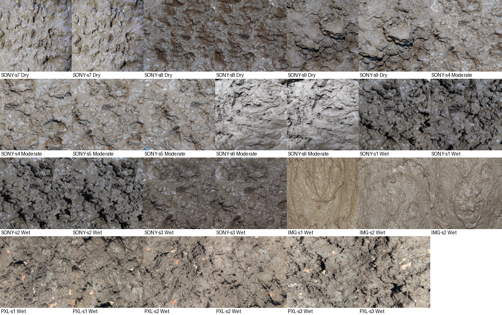

# SAWA ML studies — findings (14 October 2026)

Four studies on public, lab-labelled data, run before any SAWA-collected data
exists. They answer AI-SAWA-001's open questions with evidence instead of
assumptions. **No model here is wired into the app**; decisions belong to the
pending ADRs (ADR-009 especially).

Every number below comes from the JSON next to this file. Cross-validation is
grouped: one location (study A), one soil sample across all its phone shots
(B), one capture session (D) or one image group (C) never sits in both the
training and the test side.

---

## Summary

| # | Finding | Evidence |
|---|---|---|
| 1 | SAWA's shipped pH, P, K and soil-type outputs have **no useful agreement with lab values**, even with perfect, lab-calibrated colour | A1 |
| 2 | Colour carries a **real but modest** signal for organic carbon and total N; almost none for pH, P, K or clay | A2 |
| 3 | On real phone photos, colour predicts SOC with median **R² ≈ 0.47–0.53** on the same phone, but a model **does not transfer between phones** (R² −0.34 to 0.42) | B1, B2 |
| 4 | SAWA's "N" number for the **same soil** moves by **19 points** just by changing phone; band edges are 40 and 80 | B3 |
| 5 | With honest 90 % uncertainty, a phone-photo OC-band answer is usually **2–3 of the 3 bands**; only 13–19 % of photos get a single band | B4 |
| 6 | The shipped validation gate **accepts 78 % of ordinary non-soil photos**; 906 of them at "High confidence" | C1 |
| 7 | A trained gate separates soil from non-soil almost perfectly **within known sources**, but on a **soil source it has never seen** it rejects most real soil | C1, C2 |
| 8 | Visual moisture class: **75 %** on held-out capture sessions vs **94 %** on the leaky photo-level split the dataset card recommends | D |

**What this means for SAWA, in one paragraph.** ADR-009 (stop showing photo
N/P/K) is strongly supported: P and K are not visible in colour at all, and the
pH formula is noise. Organic carbon is the one property worth pursuing from
photos, and only with a grey card in frame (finding 3–4 is the cross-device
failure the grey card exists to fix) and with set-valued answers ("Low or
Medium"). The validation gate is the most urgent fix, but the fix is
**SAWA's own diverse soil photos** (Phase 1A), not a model trained on two
borrowed sources.

---

## Study A — 48,776 lab-analysed topsoils (Open Soil Spectral Library)

Colour is computed from each sample's measured reflectance (CIE D65, 2°), i.e.
the colour a *perfectly calibrated* camera would see on a dry, sieved sample.
This is the **best case** for any camera; field photos will do worse.
Population: top ≤ 30 cm, mineral soils (OC < 12 %), USA (KSSL), Europe (LUCAS),
global tropics (ICRAF-ISRIC). India is not represented — see Limits.

### A1. The shipped formulas vs the lab

| App output | Result | Baseline |
|---|---|---|
| pH = 7.5 − 2 × darkness | Spearman **0.13**; mean error **1.14 pH units**; puts 99.95 % of soils in "Neutral"; band agreement **30 %** | lab has 44 % Acidic, 30 % Neutral, 25 % Alkaline |
| P band | Spearman 0.14; band agreement with SHC bands **17 %** | always "High": 74 % |
| K band (fixed per soil type) | Spearman **−0.001**; agreement **17 %** | always "High": 78 % |
| Soil type (RGB rules) vs lab texture | accuracy **34 %**; 28 % labelled "Mixed" | always "Loamy": 43 % |
| N score (100 × darkness) | Spearman 0.40 with total N, 0.41 with OC | — |

### A2. What colour can learn (5-fold spatial CV, R² with 95 % cluster-bootstrap CI)

| Property | Darkness only | Colour (L\*a\*b\*) | Lab vis-NIR spectrum |
|---|---|---|---|
| Organic carbon | 0.19 [0.17–0.21] | **0.32** [0.30–0.34] | 0.66 |
| Total N | 0.19 | 0.22 | 0.56 |
| pH (H₂O) | 0.02 | 0.18 | 0.69 |
| Available P (Olsen) | 0.02 | **0.03** | 0.13 |
| Available K | 0.00 | 0.09 | 0.38 |
| Clay % | 0.00 | 0.17 | 0.60 |
| Sand % | 0.08 | 0.18 | 0.47 |
| CaCO₃ | 0.07 | 0.18 | 0.72 |
| Texture class (macro-F1) | 0.30 | 0.39 | 0.58 |

Phosphorus is not predictable even from a full lab spectrum. The spectrum
column is an upper bound for a hardware path (HW-SAWA), not for a camera.

### A3. Regional transfer (colour → OC)

Trained on Europe, tested on USA: R² 0.27; on the tropics: 0.07. Trained on
USA, tested on Europe: −0.22. Rank order survives (Spearman 0.40–0.52);
absolute calibration does not. A model must be calibrated on the region it
serves (DATA-SAWA-001 §3).

---

## Study B — 84 soils × 4 smartphones with lab SOC (Azevedo et al. 2026)

| | Result |
|---|---|
| B1 same phone, colour + random forest (20 × repeated 5-fold) | median R² **0.47–0.53**, RMSE ≈ 3.5 g/kg, RPD ≈ 1.4; OC-band accuracy 0.62–0.67 (macro-F1 0.54–0.59). Reproduces the authors' 0.30–0.47 |
| B2 train on one phone, test on another | median R² from **−0.34 to 0.42**; 5 of 12 pairs ≤ 0 |
| B3 SAWA darkness vs SOC | Spearman 0.72–0.77 on three phones, 0.36 on the fourth. Same soil, different phone: SAWA's N score moves **19.2 points** on average |
| B4 split-conformal OC band, 90 % target | coverage 0.96; mean set size **2.2–2.5 of 3**; single-band answers 13–19 % |

R² ≈ 0.5 with RPD ≈ 1.4 is "rough screening" quality in soil spectroscopy terms
(RPD < 1.4 is usually called unreliable). It is a ranking aid, not a measurement.

---

## Study C — the validation gate (AI-SAWA M-1)

The shipped gate (`src/lib/image-validation.ts`) was run **unchanged** under
Node on every image. Dataset: 1,513 soil close-ups (1,177 field photos,
Bangladesh; 336 dish-centre crops from the 4-phone set) vs 1,409 trainable
non-soil images (1,100 reuse-licensed COCO photos, 309 CC0 material textures)
plus 3,165 further COCO photos used **only for evaluation**.

| Gate | Soil accepted | Non-soil accepted (COCO train / COCO eval-only / textures) |
|---|---|---|
| **Shipped** (verdict "ok") | 100 % | **78 % / 79 % / 68 %**; 906 at "High confidence" |
| Trained tabular gate, 61 browser-computable stats | 97 % (threshold) | 0.0 % / 0.0 % / 2.9 % |
| Trained CNN (MobileNetV3-Small) | 97 % (threshold) | 0.0 % / 0.0 % / 0.65 % |

*Non-soil photos the shipped gate scored ≥ 90 % "usable soil" (COCO, CC-BY /
CC-BY-SA / public-domain images).* The cause is structural: any warm or
neutral pixel counts as "soil-coloured", so the gate is really a
"not sky, not green" filter.

**Leave-one-soil-source-out (the honest test).** Trained without the field
photos, the tabular gate accepts **2.3 %** of them; trained without the
4-phone photos, it accepts **11 %** of those. With only two narrow soil
sources, a trained gate learns "looks like these sources", not "soil".

**C2 — CNN (MobileNetV3-Small, ImageNet weights, fine-tuned on the GPU).**
Out-of-fold AUC 0.9995. At the threshold that keeps 97 % of soil photos it
accepts **0.04 %** of non-soil images (0 of 4,265 COCO photos, 0.65 % of
textures). But leave-one-soil-source-out it accepts **0 %** of the held-out
source (median probability 0.43 for the field photos, 0.0004 for the phone
photos) — it memorised the two soil sources even more completely than the
tabular gate. The ONNX export works (6.4 MB, max |Δlogit| vs PyTorch
6.7 × 10⁻⁶, opset 18) and is kept locally as a pipeline check, **not as a
shippable model**.

**Conclusion for M-1.** The model architecture is not the bottleneck; the
data is. Two soil sources are not enough to learn "soil" in general. A
shippable gate needs soil photos from many fields, phones and light
conditions — exactly what SAWA's Phase 1A capture produces — and must pass
leave-one-source-out before it replaces the shipped rules.

---

## Study D — visual moisture class (AI-SAWA M-3)

1,177 field photos, Wet / Moderate / Dry. Every capture session holds a single
class (3 sessions per class), so a photo-level random split leaks session
identity into the test set.

| Split | Tabular (LightGBM) | CNN (MobileNetV3-Small) |
|---|---|---|
| Photo-level random split (dataset card) | 93.5 % | 85.5 % |
| **Held-out sessions** | **75.2 %** | **59.0 %** (folds 69 / 82 / 25 %) |
| Majority class | 34.5 % | |

Moisture is learnable from colour statistics, but nine sessions from one site
are too few to trust any number above. The leaky split overstates accuracy
by 18–27 points, which is the general lesson for SAWA's own data: split by
sample, field and session, never by photo.

---

## Limits

- **No Indian soils with lab values were available.** OSSL has none; the phone
  set is from Brazil and the moisture set from Bangladesh. Every absolute
  number needs re-measuring on Phase 1A/1B data.
- Study A colour comes from a spectrometer on dried, sieved soil — an upper
  bound. Field photos add moisture, shadow, residue and camera effects.
- Study C resizes with area averaging; the browser's `drawImage` may differ
  slightly, which mainly affects the shipped gate's texture metric. The
  structural failure (colour rules) is unaffected.
- Unit conversions for the SHC bands assume 2.24 × 10⁶ kg soil/ha
  (mg/kg × 2.24 = kg/ha), the convention Indian labs use.
- The SAWA heuristics were evaluated without their random noise terms
  (expected values); the noise only lowers agreement further.

## Recommendations

1. **Accept ADR-009.** Remove photo N/P/K and the pH formula from the UI;
   evidence: A1, A2.
2. **Replace "soil type" with colour notation (Munsell, PR #13)** and an
   "estimated organic matter: darker / lighter" cue; texture needs a feel test.
3. **Keep the grey card** (DATA-SAWA-001 §2.2): B2/B3 are the cross-phone
   failure it addresses.
4. **Gate:** short term, tighten the shipped rules (they accept bathrooms and
   donuts); long term, train M-1 on SAWA's own diverse photos with the scripts
   here, and require a leave-one-source-out pass before shipping.
5. **Report OC as a set** ("Low or Medium") with conformal coverage, never a
   single number (AI-SAWA-001 §3), once lab-paired Indian data exists.

## Data credits

Open Soil Spectral Library v1.2 (CC-BY 4.0) · Azevedo, Costa, Sousa, Silva,
Morais (2026), Zenodo 10.5281/zenodo.22876123 (CC-BY 4.0) · Soil Moisture
Dataset for Image Based Soil Classification, Mendeley Data
10.17632/skcc44yvvg.2 (CC-BY 4.0) · COCO 2017 (images under their individual
licences; training used CC-BY, CC-BY-SA and public-domain images only) ·
CC0 Textures via `nyuuzyou/cc0-textures` (CC0).
